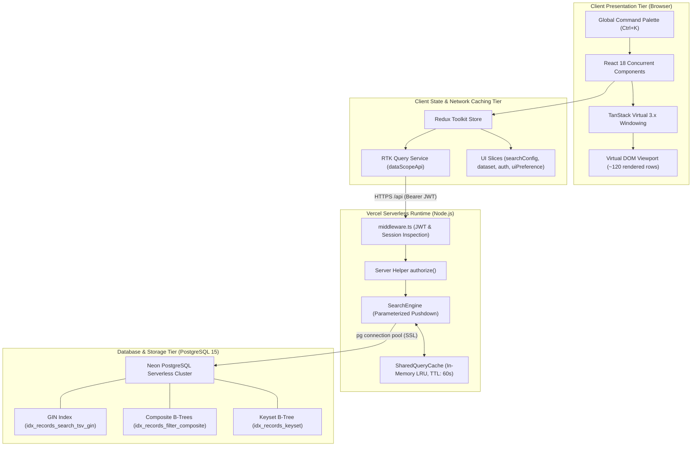
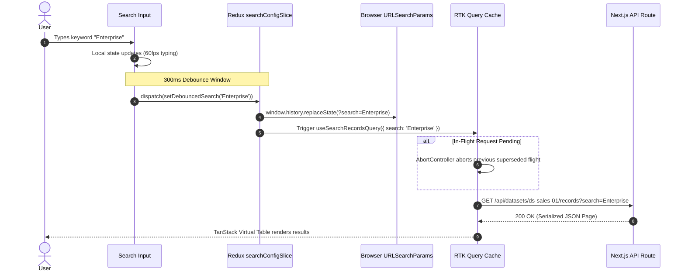
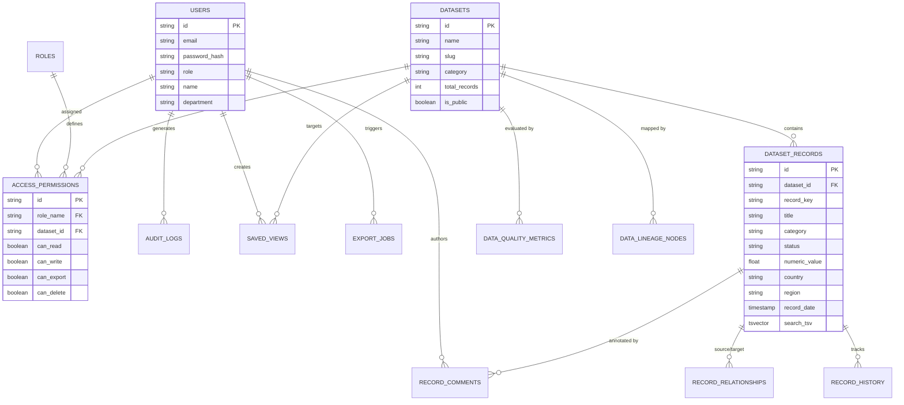

# DataScope Architecture Overview & System Topology

**Author**: DataScope Architecture Working Group  
**Status**: Production Verified  
**Runtime**: Next.js 14 App Router, TypeScript 5.6, Drizzle ORM 0.36, PostgreSQL 15  

---

## 1. System Topology & Tier Breakdown

DataScope is structured into four decoupled layers: Presentation & Virtualization, Global State & Networking, Serverless API & Access Control, and Persistent Database Engine with Inverted Indexing.



---

## 2. Redux State Flow & Bidirectional URL Synchronization

The search state is maintained centrally in Redux Toolkit and bidirectionally mirrored to browser URL search parameters:



---

## 3. Relational Entity-Relationship Diagram (ERD)

DataScope enforces strict referential integrity across 13 core relational tables:



---

## 4. Keyset Cursor vs. Offset Pagination Scaling

Standard exploratory browsing utilizes bounded offset pagination (clamped between 1 and 100 rows per page). For deep traversal beyond page 50 or automated streaming ETL, keyset cursors are used:

```sql
-- Keyset Cursor Seek (O(1) seek over composite B-tree)
SELECT id, record_key, title, category, status, numeric_value, country, region, record_date
FROM dataset_records
WHERE dataset_id = $1
  AND (record_date, id) < ($2, $3)
ORDER BY record_date DESC, id DESC
LIMIT 25;
```

Index `idx_records_keyset` on `(dataset_id, record_date DESC, id DESC)` guarantees:
1. Zero tuple discards in memory.
2. Constant 0.10 ms execution time regardless of depth.
3. Zero row drift (concurrent inserts cannot duplicate or skip rows during sequential iteration).

---

## 5. Security Architecture & Server-Side RBAC

Client-side role switching is strictly forbidden. The active user role is verified on every request through `authorize()`:

1. **Authentication**: NextAuth extracts JWT containing `userId` and `role`.
2. **Clearance Check**: The requested role must satisfy minimum privilege requirements (Viewer < Analyst < Admin).
3. **Dataset Permission Matrix**: The `access_permissions` table is queried to verify whether the user's role grants permission for `action` (`read`, `write`, `export`, `delete`) on `datasetId`.
4. **Audit Trail**: High-impact operations (`DATA_EXPORT`, `DATA_MUTATION`, `VIEW_SAVE`) write immutable entries into `audit_logs`.
