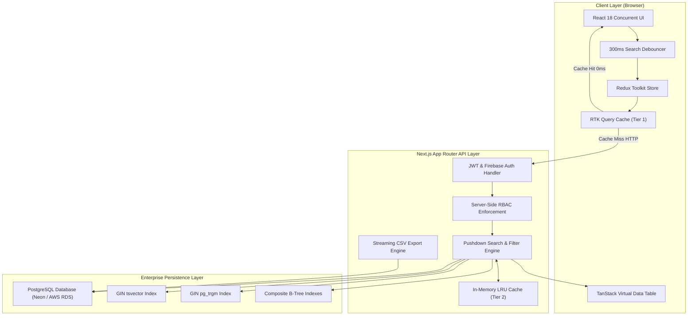
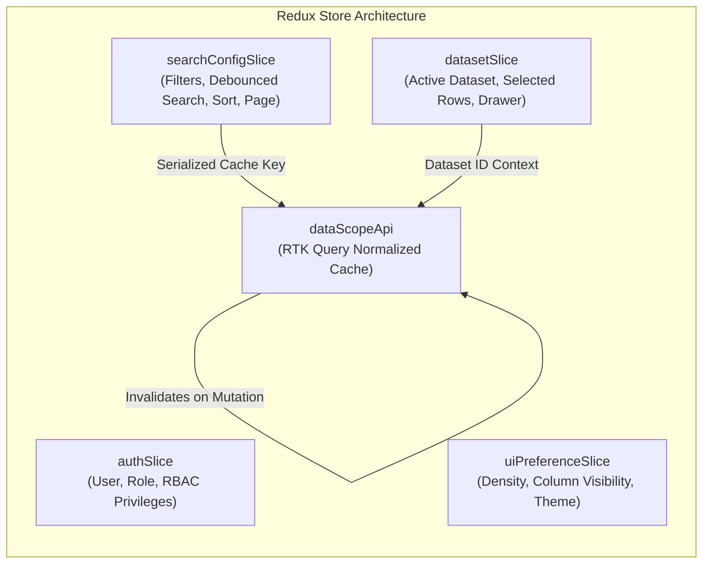
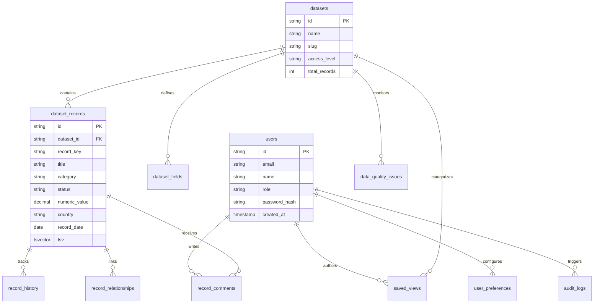

# DataScope Architecture Overview

## System Architecture

DataScope is an enterprise-grade data discovery, exploration, and intelligence platform built on Next.js 14/15 App Router, Redux Toolkit with RTK Query, PostgreSQL with Drizzle ORM, and TanStack Virtual table rendering.

---

## 2. Redux Store & State Synchronization Flow

The client state is structured into focused slices with clear separation between UI state, filter configuration, active dataset selection, and the RTK Query cache:

### Slice Responsibilities
- `searchConfigSlice`: Tracks search query, debounced search string, multi-condition filter rules, logical operator (`AND`/`OR`), sort definitions, and pagination settings.
- `datasetSlice`: Tracks the active selected dataset (`ds-sales-01`, `ds-telemetry-02`, `ds-finance-03`), multi-row selection maps (`selectedRowIds`), and detail drawer open state.
- `authSlice`: Maintains the authenticated user profile, active role (`admin`, `analyst`, `viewer`), and granular permission flags (`canExportData`, `canManageDatasets`, `canModifyRecords`).
- `uiPreferenceSlice`: Stores local UI settings such as table density (compact, comfortable, dense), custom column visibility toggles, and virtualized rendering switches.
- `dataScopeApi`: The primary RTK Query slice managing server cache lifecycle, query deduplication, optimistic updates, and tag invalidation.

---

## 3. Role-Based Access Control (RBAC) Matrix

DataScope enforces security at both the **Client UI layer** (disabling buttons, concealing restricted actions) and the **Server API layer** (verifying signed HS256 JWT tokens and denying unauthorized HTTP requests).

| Privilege Flag | Administrator | Data Analyst | Viewer | Server-Side Enforcement Point |
| :--- | :---: | :---: | :---: | :--- |
| `canManageUsers` | Allowed | Denied | Denied | `POST /api/users`, `DELETE /api/users/[id]` |
| `canManageDatasets` | Allowed | Denied | Denied | `POST /api/datasets`, `DELETE /api/datasets/[id]` |
| `canExportData` | Allowed | Allowed | Denied | `POST /api/datasets/[id]/export` |
| `canCreateSavedViews` | Allowed | Allowed | Denied | `POST /api/saved-views` |
| `canShareViews` | Allowed | Allowed | Denied | `PATCH /api/saved-views/[id]` |
| `canModifyRecords` | Allowed | Allowed | Denied | `PATCH /api/datasets/[id]/records/[recordId]` |
| `canAccessRestrictedDatasets` | Allowed | Allowed | Denied | `GET /api/datasets/ds-telemetry-02/*` |
| `canAccessAdminOnlyDatasets` | Allowed | Denied | Denied | `GET /api/datasets/ds-finance-03/*` |
| `canViewSystemAnalytics` | Allowed | Allowed | Allowed | Read-only analytics dashboard |

---

## 4. Entity Relationship Diagram

